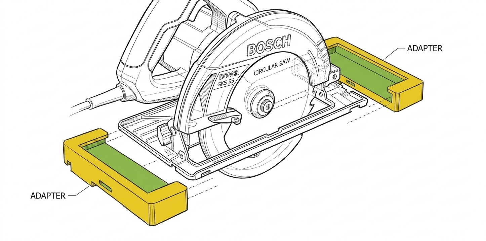

# FSN 1100 Adapter for Circular Saw

## Supported Models

| Model | Base Plate Width | Base Plate Height Front | Base Plate Height Back | Distance Blade - Ruler | STL |
| -------------| ------| ---- | --- | --- | --- |
| Bosch GKS 55 | 147mm | 11mm | 9mm | ??? | [⬇️](stl/gks55.stl) |

## Printing the adapter

- Use PETG
- Flip the adapters for printing without support.

## TODO

- [ ] Serious cleaning up
- [ ] Base plate parametrization
- [ ] Saw distance parametrization

# License

Use at your own risk...